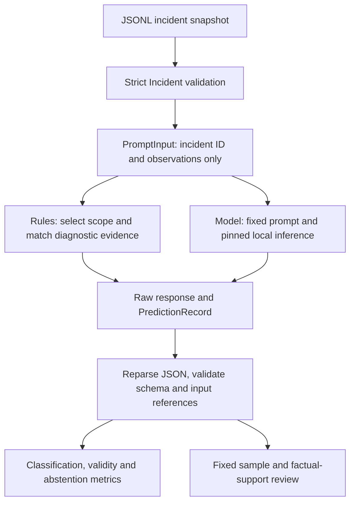

# Algorithm and code flow

LogMind takes a supplied Kubernetes incident snapshot and returns a diagnosis with supporting observation IDs and read-only checks. It does not collect live cluster data or execute repairs. Phase 0 compares two independent baselines on the same frozen incidents: deterministic Python rules and an unmodified local Qwen3-1.7B instruction model.

The model does not receive the rules answer, and the rules do not repair the model answer. There is no hybrid fallback in Phase 0.

## 1. Data preparation

[generation.py](src/logmind/generation.py) loads all 42 reviewed baseline files, validates their category/scenario/split assignments, and creates 150 records:

- 36 answerable scenarios × four variants: baseline, wording, noisy, and long.
- Six insufficient-evidence scenarios × one baseline, preserving the information gap.

Every variant keeps its scenario ID and split. A local random generator derives its seed from the configured seed, scenario ID, variant, and generator version. Incident IDs are opaque hashes of the same inputs. Stable ordering and isolated random generators make regeneration reproducible without changing Python's global random state.

Wording changes only allowlisted metadata/status framing and updates any affected gold excerpts. Noise adds 2–4 benign supplied workload notes; long variants add 32. Original diagnostic observations and structured facts remain. These are conservative input variants, not independent causal incidents.

[freezing.py](src/logmind/freezing.py) audits counts, checksums, unique IDs, evidence references, split membership, and exact regeneration. It creates a separate frozen release containing the unchanged JSONL bytes, manifests, hashes, and reproduction inputs. Verification detects changes relative to the manifest/pin; it is not filesystem write protection or a digital signature.

Entry commands: `make generate`, `make freeze`, and `make verify-dataset`.

## 2. Input boundary and schemas

[schemas.py](src/logmind/schemas.py) defines the contracts:

| Type | Purpose |
| --- | --- |
| Incident | Observations plus gold labels, root cause, supporting excerpts, expected checks, scenario ID, split, and tags. |
| PromptInput | Only incident_id and observations; this is the diagnosis input. |
| Prediction | Exact output fields, category, evidence IDs, explanation, recommendations, and uncertainty. |
| PredictionRecord | Raw response, parsed prediction or errors, run metadata, and timing. |
| RunManifest | Backend/source or model revision, tokenizer/prompt/settings, input checksum, and environment. |

`Incident.to_prompt_input()` is an explicit field allowlist. Ground-truth fields do not enter either predictor. Pydantic rejects extra fields and incorrect types; incident validation checks observation-ID uniqueness and exact gold excerpts. Prediction reference validation separately checks the incident ID and cited observation IDs.

## 3. Rules algorithm

[rules.predict()](src/logmind/rules.py) performs three steps.

**Select the diagnostic scope.** `selected_observations()` looks for metadata whose source identifies target selection. It uses the selected container and integer attempt when supplied, excluding other containers/attempts. Without an explicit selection it can infer a unique container. Multiple containers or conflicting selections cause abstention. Historical observations are excluded when no attempt is selected; metadata without an attempt cannot provide complete temporal disambiguation.

**Collect supported candidate categories.** The rules inspect observation kinds and selected structured fields/text:

| Category | Trigger |
| --- | --- |
| oom_killed | Termination reason OOMKilled, in structured data or explicit termination text. Exit 137 alone is insufficient. |
| scheduling_failure | Event reason FailedScheduling. |
| image_pull_failure | Event text explicitly reporting failure to pull an image. |
| probe_failure | Event text reporting a readiness/liveness/startup probe failure or error. |
| missing_config | Event names a ConfigMap/Secret and an absent object/key. |
| container_crash | Nonzero termination plus an application log matching fatal/unhandled exception, missing-module, or SIGSEGV signals. |

Probe/OOM evidence suppresses the generic application-crash rule so a nonzero exit does not replace a supported primary cause with its termination symptom. Other independently matched causes are not resolved by an arbitrary priority list. A missing-config match combined with optional=true metadata also causes conservative abstention; this is a simple conflict check, not full Kubernetes resource-reference resolution.

**Decide and explain.** Exactly one candidate category, without target ambiguity, produces that category. Zero candidates, multiple candidates, or contradictory scope produce insufficient_evidence and uncertain=true. Matched evidence IDs are deduplicated and sorted. The response uses a fixed conservative root-cause sentence and read-only check; the explanation quotes up to three supporting observations. Abstention uses the first three observations by ID as context, which is deterministic but not a sophisticated explanation selector.

This is pattern matching, not training, causal simulation, or a complete Kubernetes reasoner. Generic explanations can be less specific than the snapshot. Unknown phrasing and subtle temporal/resource relationships remain limitations.

## 4. Rules execution flow

`make rules` → [cli.predict_rules()](src/logmind/cli.py) → [pipeline.run_rules()](src/logmind/pipeline.py):

1. Verify the frozen release and read the requested split.
2. Hash the rules source and input JSONL; construct RunManifest.
3. Convert each Incident to PromptInput, call `rules.predict()`, and serialize its response.
4. Parse/validate that response into PredictionRecord and record elapsed time.
5. Write raw records, valid-only convenience predictions, source/config metadata, metrics, and a review worksheet into a new run directory.

The rules baseline works on CPU without model dependencies or cluster access. The default split is validation; test evaluation requires selecting test explicitly.

## 5. Local-model execution flow

`make model` → [cli.predict_model()](src/logmind/cli.py) → [model_pipeline.run_model()](src/logmind/model_pipeline.py):

1. Verify the frozen release and validate the strict ModelConfig.
2. [local_model.LocalModel](src/logmind/local_model.py) loads the exact cached model/tokenizer commits, using native Transformers code with remote code disabled.
3. [prompts.messages()](src/logmind/prompts.py) supplies a fixed zero-shot system instruction and the complete PromptInput JSON.
4. Apply the tokenizer chat template with thinking disabled; count tokens and reject over-limit inputs without truncation.
5. Generate greedily in BF16 on CUDA using SDPA and the fixed seed/thread/output limits. No adapter or quantization is used.
6. Decode the response, preserve it verbatim as text, and pass it through the shared parser. There is no Markdown stripping, JSON repair, or rules fallback.
7. Save every record and token/timing/memory measurement. Inference failures retain an empty/failed response and error metadata rather than silently removing a case.

`make download-model` obtains the pinned public files first. Actual inference uses local cached files. Optional Torch/Transformers imports are deferred so CPU commands remain usable without the model extra.

## 6. Parsing and evaluation

[evaluation.parse_response()](src/logmind/evaluation.py) distinguishes JSON parse errors, strict prediction-schema errors, and incident/evidence-reference errors. Original raw text is always retained. A raw response containing Markdown fences fails JSON validation even if valid JSON appears inside those fences.

[pipeline.evaluate_files()](src/logmind/pipeline.py) checks the dataset checksum and loads authoritative records.jsonl. `assess()` reparses raw_response instead of trusting stored parsed fields. Unknown/duplicate incident IDs and mixed run/configuration metadata are artifact errors. Missing outputs remain part of the denominator.

`evaluate()` computes:

- Accuracy over every incident; invalid or missing predictions are incorrect.
- Accuracy restricted to answerable cases.
- Per-class support, precision, recall, F1, and a confusion matrix with an invalid column.
- Macro-F1 as the mean of the six answerable-class F1 values, including zeros for undefined/absent classes.
- Separate full-N parse, schema, and reference-validity rates.
- Abstention behavior, including missing-diagnostic versus target-ambiguity groups.

For each class, `F1 = 2 × TP / (gold support + predicted support)`; undefined values become zero. Abstaining on an answerable case is a false negative for its gold class. Predicting a class on a gold insufficient-evidence case creates a false positive for that class.

Use `records.jsonl` for evaluation. `predictions.jsonl` contains only parsed predictions and would hide failures if treated as the denominator.

## 7. Factual review and benchmarking

Automatic flags are narrow: unknown evidence IDs, explicitly quoted unobserved resource names, and explicit numeric exit/restart contradictions. They do not establish whether every claim is supported.

`prepare_review()` selects the preregistered deterministic class/invalid/abstention sample. [review.py](src/logmind/review.py) validates completed ratings against unchanged original sample facts and computes unsupported-claim numerator/denominator. The published Phase 0 reviews identify Codex as a single agent reviewer; they are not independent human reviews.

[benchmark.py](src/logmind/benchmark.py) selects the same seven hash-chosen held-out inputs for both backends. [benchmark_worker.py](src/logmind/benchmark_worker.py) executes three cold repetitions per case in separate processes, then one discarded warm-up and three complete warmed repetitions. Reports preserve raw measurements and compute median/p95 latency, tokens/throughput, CPU RSS, and CUDA allocated/reserved peaks. These seven cases contain no long variant; full-test memory maxima are reported separately.

See [Phase 0 results](experiments/PHASE0_REPORT.md) and [reproduction commands](experiments/PHASE0_REPRODUCE.md). The rules' 100% and model's 50% accuracy describe this small synthetic test set, not production reliability.
